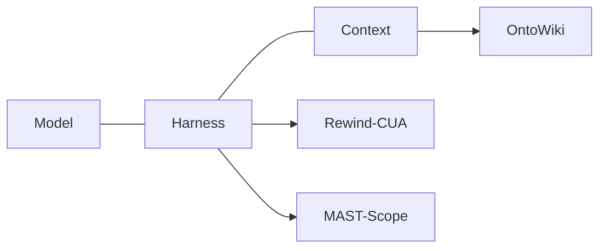

  

  <strong>Frontier full-stack AI agent engineer</strong> 
  前沿全栈 AI Agent 工程师 
  <em>I build agents that remember, verify, and can be rewound.</em> 
  <em>我做会记忆、会自检、能回滚的 Agent。</em>

  Building reliable AI agents — knowledge compilation, memory, computer-use, multi-agent. 
  构建可靠的 AI Agent｜知识编译 · 记忆 · Computer-Use · 多智能体

### Now · 正在做

Three active builds. The original layer is still in progress; the note under the table is the current state of each tree.

三件正在做的事。原创的那一层还在推进，每个仓库现在到哪一步，写在表下面。

- **[OntoWiki](https://github.com/zysen1/OntoWiki)** — WIP. Ontology-grounded, bi-temporal LLM-compiled knowledge base. 本体约束、带双时态的 LLM 编译知识库。
- **[Rewind-CUA](https://github.com/zysen1/Rewind-CUA)** — WIP. Computer-use harness with checkpoints, rollback, and uncertainty escalation. 可回滚、会求助的电脑操作 Agent。
- **[MAST-Scope](https://github.com/zysen1/MAST-Scope)** — WIP. Flight recorder for multi-agent systems: detect, attribute, repair. 多智能体黑匣子：检测、归因、修复。

### Flagship · 代表项目

| Project | What | Built on |
| --- | --- | --- |
| [OntoWiki](https://github.com/zysen1/OntoWiki) · WIP | Ontology-constrained, bi-temporal compiled wiki. A page has to pass the schema. Each claim keeps valid time and ingest time. A conflict retires the old claim and leaves the history in place. 本体校验的编译式 wiki：论断带有效时间与写入时间，冲突只让旧论断失效，历史保留。 | [llmwiki](https://github.com/lucasastorian/llmwiki) · Apache-2.0 [Graphiti](https://github.com/getzep/graphiti) · Apache-2.0 · planned store |
| [Rewind-CUA](https://github.com/zysen1/Rewind-CUA) · WIP | Action journal, a checkpoint before a hard-to-undo step, rollback when the check fails, escalation when confidence is low or the action is costly. 动作日志；难撤销的步骤前做检查点；校验失败就回滚；没把握，或动作代价高，就升级给人。 | [cua](https://github.com/trycua/cua) · MIT |
| [MAST-Scope](https://github.com/zysen1/MAST-Scope) · WIP | Online detection against the MAST failure taxonomy, attribution back to the first bad step, then a repair pass on that subtask. Offline evals packaged as an Inspect task. 对照 MAST 做在线检测，归因到第一个出错的步骤，再重修那个子任务。离线评测做成 Inspect 任务。 | [OpenAI Agents SDK](https://github.com/openai/openai-agents-python) · MIT · intended runtime [Inspect AI](https://github.com/UKGovernmentBEIS/inspect_ai) · MIT · intended evals |

Current tree. [OntoWiki](https://github.com/zysen1/OntoWiki) is a fork identical to [llmwiki](https://github.com/lucasastorian/llmwiki). [Rewind-CUA](https://github.com/zysen1/Rewind-CUA) is a fork identical to [cua](https://github.com/trycua/cua). [MAST-Scope](https://github.com/zysen1/MAST-Scope) is an initial commit; the Agents SDK and Inspect AI are the intended base. Benchmark figures land after a reproducible run.

仓库现状：OntoWiki 目前与上游 llmwiki 完全一致，Rewind-CUA 目前与上游 cua 完全一致，MAST-Scope 只有初始提交。Agents SDK 和 Inspect AI 是预定的底座。数字等可复现的运行出来再写。

*Intended shape.* OntoWiki is the knowledge layer the other two can read. Rewind-CUA and MAST-Scope sit on the harness: one makes a run reversible, the other makes a failure attributable.

*预定的结构。* OntoWiki 是另外两件可以读的知识层。Rewind-CUA 和 MAST-Scope 落在 harness 上：一个让一次执行可以倒回去，一个让一次失败可以归因。

### In the lab · 筹备中

Three more, still on paper. No repositories yet.

还有三件，停在纸面上。仓库还没建。

- **Grounded-Hermes** — planned. A personal-agent plugin: a common-ground ledger (confirmed, inferred, expired, each with a source and a way to retract) and memory scoped by permission. 个人 Agent 插件：一张共同认知账本（已确认、推测、过期，带来源，可撤回），记忆按权限分域。 Planned as a plugin for [hermes-agent](https://github.com/NousResearch/hermes-agent) · MIT.
- **SWE-Bank** — planned. A small coding agent that banks reasoning from successes and failures and gets better before any weight update. 一个小的 coding agent：从成功和失败的轨迹里攒推理记忆，先不改权重。 Planned on [mini-swe-agent](https://github.com/SWE-agent/mini-swe-agent) · MIT.
- **mcp-warden** — planned. A Go gateway in front of MCP and A2A: pinned tool descriptions, a per-agent ACL, an audit trail. Go 写的 MCP / A2A 网关：钉住工具描述、按 agent 身份做 ACL、留下审计。 Planned on [mcp-go](https://github.com/mark3labs/mcp-go) · MIT, with A2A shapes from [a2a-python](https://github.com/a2aproject/a2a-python) · Apache-2.0.

### My take on agents · 我对 Agent 走向的判断

Seven bets. Each one is anchored to the post, repository, or paper it comes from.

七个判断。每条都挂着它的帖子、仓库或论文。

**1 · The harness is the product.**
Harness 就是产品。

Agents = model + harness + context. The gains now come from context and control loops, not from another framework.
现在的提升主要来自上下文和控制回路，而不是换一个框架。

Evidence. Harrison Chase, [agents = model + harness + context](https://x.com/hwchase17/status/2088653366335582629) (2026-08); the same shape under Claude Code and Manus, [model + runtime + harness](https://x.com/hwchase17/status/2034297125417460044) (2026-03). OpenAI open-sourced the [Agents SDK harness](https://x.com/OpenAIDevs/status/2044466699785920937) (2026-04) and the [Codex harness](https://x.com/OpenAIDevs/status/2090230646497251387) (2026-08). The same bet shows up in harness and plugin repos: [ECC](https://github.com/affaan-m/ECC), [deepseek-harness](https://github.com/deepseek-ai/deepseek-harness), [Archon](https://github.com/coleam00/Archon). Papers: [the context fails first](https://arxiv.org/abs/2607.14275); [ACE](https://arxiv.org/abs/2510.04618), context as an evolving playbook.

**2 · Compile knowledge, don't re-retrieve it.**
知识要编译，而不是每次重新检索。

An LLM-maintained wiki accumulates synthesis. A flat markdown wiki still needs types, time, and provenance.
LLM Wiki 会让知识持续积累。平铺的 markdown wiki 仍缺本体、时间维度和溯源。

Evidence. Karpathy, [LLM Wiki](https://gist.github.com/karpathy/442a6bf555914893e9891c11519de94f) (2026-04), and the follow-up that this kind of memory is [explicit and inspectable](https://x.com/karpathy/status/2040572272944324650). Jerry Liu: [the retrieval harness is the 2026 version of RAG](https://x.com/jerryjliu0/status/2071729856900215261); [the context layer is one of the few moats](https://x.com/jerryjliu0/status/2053178322495152261). Implementations: [llmwiki](https://github.com/lucasastorian/llmwiki), [llm-wiki-compiler](https://github.com/atomicstrata/llm-wiki-compiler), [nvk/llm-wiki](https://github.com/nvk/llm-wiki). Preregistered comparisons: [vector RAG vs an LLM-compiled wiki](https://arxiv.org/abs/2605.18490), [progressive disclosure](https://arxiv.org/abs/2607.04576). The gap those wikis leave open: [Graphiti](https://github.com/getzep/graphiti), [BEACON-SP](https://arxiv.org/abs/2610.09026), [an auditable GraphRAG workspace](https://arxiv.org/abs/2610.23559).

**3 · Memory belongs inside the harness, and it should dream.**
记忆应该放进 harness，并在后台离线整理（“做梦”）。

Memory never landed as a sidecar. It has to live in the harness, and the useful part of the work happens off the request path: dreaming, heartbeats, a sub-agent that writes the wiki back.
记忆没能单独做成一个外挂。它得长在 harness 里面，真正有用的整理发生在请求之外：做梦、心跳、一个把 wiki 写回去的子 agent。

Evidence. Harrison Chase on memory having to be [integrated with the harness](https://x.com/hwchase17/status/2099858455079026817) (2026-09), and on [dreaming, async sub-agents, heartbeats, and letting the agent schedule itself](https://x.com/hwchase17/status/2110813795245249018) (2026-10). The concrete loop: [openwiki reads traces and writes the repo wiki back](https://x.com/hwchase17/status/2082536230181650862). Repos: [claude-mem](https://github.com/thedotmack/claude-mem), [ai-memory](https://github.com/akitaonrails/ai-memory). Papers: [ReasoningBank](https://arxiv.org/abs/2509.25140), [Memento](https://arxiv.org/abs/2508.16153), [MemOS](https://arxiv.org/abs/2507.03724). Evals are moving past downstream QA: [Beyond Downstream QA](https://arxiv.org/abs/2610.22209).

**4 · Computer-use 2.0 is background, window-scoped, small, and reversible.**
Computer-Use 2.0：后台运行、按窗口操作、小模型执行，同时必须可监督、可回滚。

The loop is leaving screenshot-and-cursor. A coding agent orchestrates; a small system-1 model acts inside a window. Professional software is still brittle, so the harness has to escalate, and it has to rewind.
这条循环正在离开「截图加光标」。coding agent 负责编排，小的 system-1 模型在窗口里动手。专业软件上它仍然很脆，所以 harness 必须会升级，也必须能倒带。

Evidence. Cua on [window-scoped computer use, orchestrated by a coding agent](https://x.com/trycua/status/2064744390615343480), the small model [CUA-S1](https://x.com/trycua/status/2101014004927729737), and [training it with RLOO on real tasks](https://x.com/trycua/status/2102800643794591833). [Gemini 3.5 Flash](https://x.com/GoogleDeepMind/status/2070180509523546481) ships native computer use. On Cua's own report, the best model finished 6 of 25 KiCad tasks in Cua-Bench ([post](https://x.com/trycua/status/2066597808132776150)). Papers on oversight and recovery: [LEASH](https://arxiv.org/abs/2610.22280), [Task-State Governance](https://arxiv.org/abs/2610.20100), [GraceBench](https://arxiv.org/abs/2610.19900). The call for a safe harness — ACLs, no deletes, versioned actions — is [this post](https://x.com/mr_bytestorm/status/2078125282654027949).

**5 · Multi-agent is bottlenecked by observability, not by more agents.**
多智能体的瓶颈在可观测性和失败归因，而不是 agent 的数量。

Fleets and multi-agent APIs are already here. Tracing records a run. The open work is automatic detection, attribution, and repair.
舰队式工作台和多 agent API 已经有了。现有 tracing 负责记下一次运行。还缺的是自动检测、归因和修复。

Evidence. [Orca](https://github.com/stablyai/orca), parallel coding agents. Simon Willison on [multi-agent and programmatic tool calling in the GPT-5.6 API](https://x.com/simonw/status/2075306164993315192). DeepMind's [Co-Scientist](https://x.com/GoogleDeepMind/status/2061857539977842793), a generate–debate–evolve multi-agent system. Papers: [Why Do Multi-Agent LLM Systems Fail?](https://arxiv.org/abs/2503.13657) (MAST), [HTN-Orchestrate](https://arxiv.org/abs/2610.22195).

**6 · Personal agents and org agents will split.**
个人 Agent 和组织 Agent 会分化。

A company OS has many principals and one executor. A personal agent has one principal, and it has to know what the two of you already established. Its memory needs a permission boundary.
公司 OS 是多个 principal（委托人）、一个执行者。个人 Agent 只有一个 principal，而且得知道「我们之间已经确认过什么」。记忆要有权限边界。

Evidence. Harrison Chase on [the company OS versus the personal agent](https://x.com/hwchase17/status/2104940633018577400). Repos: [Hermes Agent](https://github.com/NousResearch/hermes-agent), [OpenBot](https://github.com/CopilotKit/OpenBot). Papers: [Knowing the User Is Not Knowing What We Established](https://arxiv.org/abs/2610.18684), [X-AgentRed](https://arxiv.org/abs/2610.13886), [SAFE-Mem](https://arxiv.org/abs/2610.22959).

**7 · Self-improve in context first, RL second.**
先在上下文层自我改进，再上 RL。

A large share of the gain is available in the context and in an experience bank, with the weights left alone. RL is the second step, for when that loop stops paying.
相当一部分收益，在上下文和经验库这一层就能拿到，权重先不动。RL 是第二步，等这条回路不再划算时再上。

Evidence. [Training-Free GRPO](https://arxiv.org/abs/2510.08191), [ACE](https://arxiv.org/abs/2510.04618), [ReasoningBank](https://arxiv.org/abs/2509.25140). When a training run is actually due: [ART](https://github.com/OpenPipe/ART), [Agent Lightning](https://github.com/microsoft/agent-lightning), [verl](https://github.com/verl-project/verl). Cua training the computer-use model with RLOO is that second step in the open ([post](https://x.com/trycua/status/2102800643794591833)).

### Stack · 技术栈

  

  
  
  
  

Python · TypeScript · Next.js · Rust · Go · FastAPI · MCP · A2A · OpenAI Agents SDK · LangGraph · Graphiti · Neo4j · Postgres · pgvector · Docker · microVM · OpenTelemetry · Langfuse · Inspect AI

How the languages split across this lab: Python for the agent, the graph, and the evals; TypeScript and Next.js for the UI; Rust for the local journal next to the Cua driver; Go for the MCP / A2A gateway.

语言怎么分工：Python 写 agent、图谱和评测；TypeScript / Next.js 写界面；Rust 写本机 journal，跟 Cua 的 driver 放在一起；Go 写 MCP / A2A 网关。

### Reading · 在读

A short shelf. The projects above are aimed at these.

一份短书单。上面的项目，是对着这些做的。

- [LLM Wiki](https://gist.github.com/karpathy/442a6bf555914893e9891c11519de94f) — Andrej Karpathy, 2026-04, an essay published as a gist. Compile the wiki and keep it. 把知识编译成 wiki，然后持续维护。
- [Agentic Context Engineering: Evolving Contexts for Self-Improving Language Models](https://arxiv.org/abs/2510.04618) — context as a playbook that can evolve without a weight update. 上下文是一份可以进化的 playbook。
- [Single-Round Vector RAG vs an LLM-Compiled Wiki](https://arxiv.org/abs/2605.18490) — a preregistered comparison of retrieving once against a maintained wiki. 预注册对比：单轮向量检索，对持续维护的 wiki。
- [Why Do Multi-Agent LLM Systems Fail?](https://arxiv.org/abs/2503.13657) — the MAST taxonomy. MAST 的失败分类。
- [Task-State Governance: A Virtual Machine for Verifiable and Recoverable GUI Agent Execution](https://arxiv.org/abs/2610.20100) — computer use that can be checked and restored. 可以校验、可以恢复的 GUI 执行。
- [Knowing the User Is Not Knowing What We Established: Grounding Awareness in Personal Agents](https://arxiv.org/abs/2610.18684) — common ground: what the two of you have already established. 要的是双方已经确认过的共同认知。
- [Training-Free Group Relative Policy Optimization](https://arxiv.org/abs/2510.08191) — relative advantage over sampled attempts, applied to the experience bank. 同一次任务采样多个解，用相对优势更新经验库。
