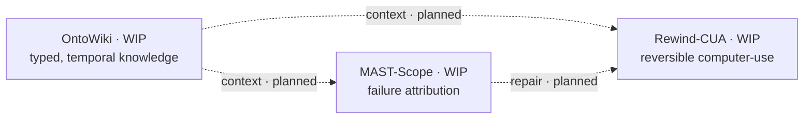

  

  <strong>Frontier full-stack AI agent engineer</strong> 
  <strong>前沿全栈 AI Agent 工程师</strong>

  <em>I build agents that remember, verify, and can be rewound.</em> 
  <em>我做会记忆、会自检、能回滚的 Agent。</em>

  Building reliable AI agents — knowledge compilation, memory, computer-use, multi-agent. 
  构建可靠的 AI Agent｜知识编译 · 记忆 · Computer-Use · 多智能体

An agent, the way I want to build one, is a model, a harness, and a context. Control lives in the harness. Knowledge and memory live in the context. The three repositories below are that sentence, and they are early.

我想做的 Agent，就是模型、harness 和上下文。控制在 harness 里，知识和记忆在上下文里。下面三个仓库就是这句话，而且都很早。

## Now / 正在做

- **[OntoWiki](https://github.com/zysen1/OntoWiki)** — types, time, and provenance on a compiled wiki. 
  给编译出来的 wiki 加上类型、时间和溯源。
- **[Rewind-CUA](https://github.com/zysen1/Rewind-CUA)** — computer-use that can be stopped and rolled back. 
  能停下来、能倒带的电脑操作。
- **[MAST-Scope](https://github.com/zysen1/MAST-Scope)** — a flight recorder for multi-agent failures. 
  多智能体的黑匣子：检测、归因、修复。

## Flagship / 代表项目

| Project | Direction | Status | Built on |
| --- | --- | --- | --- |
| [OntoWiki](https://github.com/zysen1/OntoWiki) | An LLM wiki whose claims have types, valid time, and provenance. A contradiction closes a claim instead of overwriting it. A background lint dreams through contradictions, stale pages, and broken links.  论断带类型、有效时间和出处。冲突把旧论断标为失效，保留历史。后台 lint 清扫矛盾、过期页和断链。 | WIP fork · matches upstream 与上游提交一致 | [lucasastorian/llmwiki](https://github.com/lucasastorian/llmwiki) · Apache-2.0  Planned store: [Graphiti](https://github.com/getzep/graphiti) · Apache-2.0 |
| [Rewind-CUA](https://github.com/zysen1/Rewind-CUA) | A computer-use harness with an action journal, a snapshot before the risky step, and an escalation when the next action is uncertain or hard to undo.  每个动作留日志，危险步骤前打快照。不确定，或这一步难以撤销，就升级。 | WIP fork · matches upstream 与上游提交一致 | [trycua/cua](https://github.com/trycua/cua) · MIT |
| [MAST-Scope](https://github.com/zysen1/MAST-Scope) | Detect a [MAST](https://arxiv.org/abs/2503.13657) failure while the run is live, name the first bad step, and attempt a repair.  运行中对照 MAST 发现失败，指出第一个出错的步骤，并尝试修复。 | WIP scaffold 脚手架 | [OpenAI Agents SDK](https://github.com/openai/openai-agents-python) · MIT [Inspect AI](https://github.com/UKGovernmentBEIS/inspect_ai) · MIT  Intended runtime and evals. Not imported yet. 预定的运行时和评测，尚未接入。 |

> **As of this page.** OntoWiki and Rewind-CUA are forks and still match upstream commit-for-commit. MAST-Scope is a license and a one-line README. The direction column is the plan. There is no benchmark number here that I have reproduced, and no merged upstream pull request with my name on it.
>
> **写到这里时。** 两个 fork 的提交仍与上游完全一致。MAST-Scope 只有许可证和一行 README。方向栏是计划。这里没有我自己复现的评测数字，也没有我合入上游的 PR。

The edges are the plan. The calls are still to be written.
连线是计划。调用还没写。

## In the lab / 实验室

Planned. No repository yet.
已计划，还没有仓库。

- **Grounded-Hermes** — planned. A plugin for [Hermes Agent](https://github.com/NousResearch/hermes-agent) (MIT), not a fork: a ledger of what the two of us have actually confirmed, and memory with a permission boundary.
  计划中。给 Hermes Agent 做插件，不另起一个 fork：一份「已确认 / 推测 / 过期」的共同认知账本，以及带权限的记忆。
- **SWE-Bank** — planned. An experience bank on [mini-swe-agent](https://github.com/SWE-agent/mini-swe-agent) (MIT), following [Training-Free GRPO](https://arxiv.org/abs/2510.08191) and [ReasoningBank](https://arxiv.org/abs/2509.25140). The learning curve waits until I have run one.
  计划中。在 mini-swe-agent 上积累推理记忆。学习曲线等我自己跑出来再画。
- **mcp-warden** — planned. A Go gateway depending on [mcp-go](https://github.com/mark3labs/mcp-go) (MIT), not a fork of it: pin tool descriptions, authorize by agent identity, and bridge [MCP](https://github.com/modelcontextprotocol/modelcontextprotocol) to [A2A](https://github.com/a2aproject/A2A).
  计划中。依赖 mcp-go 的 Go 网关，不是它的 fork：钉死工具描述、按 agent 身份授权、把 MCP 桥到 A2A。

## My take on where agents are going / 我对 Agent 走向的判断

Seven judgments. Each one is pinned to a post, a repository, or a paper. Star counts stay off this page; they move.

七个判断。每条都挂着帖子、仓库或论文。这一页不写 star 数，那个数字会变。

### 1 · The harness is the product

**Harness 就是产品。** Agents = model + harness + context; the gains now come from context and control loops, not frameworks.
现在的提升主要来自上下文和控制回路，而不是换一个框架。

- Harrison Chase — [agents = model + harness + context](https://x.com/hwchase17/status/2088653366335582629) (2026-08). [Claude Code and Manus share that shape: model + runtime + harness](https://x.com/hwchase17/status/2034297125417460044) (2026-03).
- OpenAI — [the Agents SDK harness, open-sourced](https://x.com/OpenAIDevs/status/2044466699785920937) (2026-04); [the Codex harness](https://x.com/OpenAIDevs/status/2090230646497251387) (2026-08).
- The repositories that moved are harnesses and plugin catalogs: [ECC](https://github.com/affaan-m/ECC), [deepseek-harness](https://github.com/deepseek-ai/deepseek-harness), [Archon](https://github.com/coleam00/Archon).
- Papers — [AI Agents Do Not Fail Alone: The Context Fails First](https://arxiv.org/abs/2607.14275). [Agentic Context Engineering](https://arxiv.org/abs/2510.04618): context as a playbook you can evolve.

### 2 · Compile knowledge, don't re-retrieve it

**知识要编译，而不是每次重新检索。** LLM-maintained wikis beat query-time RAG for accumulating synthesis — but they need types, time, and provenance.
LLM Wiki 会让知识持续积累，但它需要本体、时间维度和溯源。

- Andrej Karpathy — [LLM Wiki](https://gist.github.com/karpathy/442a6bf555914893e9891c11519de94f) (2026-04): raw sources, a wiki the model maintains, a schema. Three operations: ingest, query, lint. The personalization he argues for is [explicit and inspectable](https://x.com/karpathy/status/2040572272944324650).
- Jerry Liu — [“Retrieval Harness is the 2026 version of RAG”](https://x.com/jerryjliu0/status/2071729856900215261). [The context layer may be one of the few moats of 2026](https://x.com/jerryjliu0/status/2053178322495152261).
- Implementations — [llmwiki](https://github.com/lucasastorian/llmwiki), [llm-wiki-compiler](https://github.com/atomicstrata/llm-wiki-compiler), [nvk/llm-wiki](https://github.com/nvk/llm-wiki).
- Preregistered comparisons — [Single-Round Vector RAG vs an LLM-Compiled Wiki](https://arxiv.org/abs/2605.18490), [Progressive Disclosure for LLM-Maintained Wiki](https://arxiv.org/abs/2607.04576).
- A flat markdown wiki still lacks types, time, and provenance. What that leaves open is a bi-temporal graph ([Graphiti](https://github.com/getzep/graphiti)), ontology-constrained GraphRAG ([BEACON-SP](https://arxiv.org/abs/2610.09026)), and [a GraphRAG workspace you can audit and steer](https://arxiv.org/abs/2610.23559).

### 3 · Memory belongs inside the harness, consolidated offline

**记忆应该放进 harness，并在后台离线整理（“做梦”）。**

- Harrison Chase — memory never quite landed, he argues, because [it has to be built into the harness](https://x.com/hwchase17/status/2099858455079026817) (2026-09). The direction he flags is [dreaming, async sub-agents, heartbeats, and an agent that schedules itself](https://x.com/hwchase17/status/2110813795245249018) (2026-10). One instance: [openwiki reads traces and writes them back into a repository wiki](https://x.com/hwchase17/status/2082536230181650862).
- In the wild — [claude-mem](https://github.com/thedotmack/claude-mem) compresses a session and injects it into the next. [ai-memory](https://github.com/akitaonrails/ai-memory) (Rust) shares long-term memory across coding harnesses.
- Papers — [ReasoningBank](https://arxiv.org/abs/2509.25140), [Memento](https://arxiv.org/abs/2508.16153), [MemOS](https://arxiv.org/abs/2507.03724). The eval has to move with the claim: [downstream QA is not enough](https://arxiv.org/abs/2610.22209).

### 4 · Computer-use 2.0 is background, window-scoped, and reversible

**Computer-Use 2.0：后台运行、按窗口操作、小模型执行，同时必须可监督、可回滚。**

- Cua — the loop is leaving “screenshot plus cursor” for [window-scoped actions, orchestrated by a coding agent](https://x.com/trycua/status/2064744390615343480). They shipped [CUA-S1](https://x.com/trycua/status/2101014004927729737), a small model for computer-use decisions, and [trained it with RLOO on real tasks](https://x.com/trycua/status/2102800643794591833).
- [Gemini 3.5 Flash has native computer use](https://x.com/GoogleDeepMind/status/2070180509523546481). On professional software the hit rate is still low. On 25 KiCad tasks in Cua-Bench, [Cua reports the best model finished 6](https://x.com/trycua/status/2066597808132776150). That figure is theirs.
- The papers are about supervision and recovery. [LEASH](https://arxiv.org/abs/2610.22280) escalates under uncertainty. [Task-State Governance](https://arxiv.org/abs/2610.20100) makes GUI execution verifiable and recoverable. [GraceBench](https://arxiv.org/abs/2610.19900) asks why a GUI agent fails. Practitioners are asking for [a safe harness: ACLs, no silent deletes, versioned actions](https://x.com/mr_bytestorm/status/2078125282654027949).

### 5 · Multi-agent is bottlenecked by observability

**多智能体的瓶颈在可观测性和失败归因，而不是 agent 的数量。**

Role-play chat is giving way to async fleets and an orchestrator. Tracing is already common. Automatic detection, attribution, and repair are the open work.
角色扮演式聊天正在让位给异步子 agent 舰队加编排。追踪已经常见。还没做完的是自动检测、归因和修复。

- [Orca](https://github.com/stablyai/orca) runs coding agents in parallel. [Simon Willison on the GPT-5.6 API](https://x.com/simonw/status/2075306164993315192): multi-agent and programmatic tool calling. DeepMind’s [Co-Scientist](https://x.com/GoogleDeepMind/status/2061857539977842793) generates, debates, and evolves.
- [Why Do Multi-Agent LLM Systems Fail?](https://arxiv.org/abs/2503.13657) is the MAST taxonomy. [HTN-Orchestrate](https://arxiv.org/abs/2610.22195) is one way to replan the piece that failed.

### 6 · Personal agents and organizational agents will diverge

**个人 Agent 和组织 Agent 会分化。** A personal agent needs shared ground — what the two of you have already confirmed — and memory with a permission boundary.
个人 Agent 的关键是共同认知（彼此已经确认过什么），以及带权限的记忆。

- Harrison Chase separates [a company OS, many principals and one executor, from a personal agent](https://x.com/hwchase17/status/2104940633018577400).
- The codebases I would extend, as plugins, are [Hermes Agent](https://github.com/NousResearch/hermes-agent) and [OpenBot](https://github.com/CopilotKit/OpenBot).
- [Knowing the User Is Not Knowing What We Established](https://arxiv.org/abs/2610.18684). [X-AgentRed](https://arxiv.org/abs/2610.13886) red-teams the personal agent. [SAFE-Mem](https://arxiv.org/abs/2610.22959) puts a fine-grained authority on each memory.

### 7 · Self-improve in context first, RL second

**先在上下文层自我改进，再上 RL。** A large share of the gain is available before any weight update. Train when the context loop runs out of road.
很大一部分收益，在改权重之前就能拿到。上下文这条路走到头，再训练。

- Before a gradient: [Training-Free Group Relative Policy Optimization](https://arxiv.org/abs/2510.08191), [Agentic Context Engineering](https://arxiv.org/abs/2510.04618), [ReasoningBank](https://arxiv.org/abs/2509.25140).
- When training is the right next step: [ART](https://github.com/OpenPipe/ART), [Agent Lightning](https://github.com/microsoft/agent-lightning), [verl](https://github.com/verl-project/verl). Cua’s [RLOO run](https://x.com/trycua/status/2102800643794591833) is the shape I trust: a small model, a real environment, a harness that already exists.

## Stack / 技术栈

  

  
  
  
  
  
  

The icons are the languages these repositories will actually be written in. The row under them is the protocol and runtime layer around that code.

图标是这些仓库真正会用的语言。下面一排是围着这些代码的协议和运行时。

| Piece | Where it earns a place |
| --- | --- |
| Python, FastAPI | Agent core, wiki lint, detectors, evals. |
| TypeScript, Next.js | The graph, the timeline, and the trace view, once those interfaces exist. |
| Rust | Action journal and snapshot coordination, beside the Cua driver. |
| Go | mcp-warden, when it starts. One binary for a gateway. |
| MCP, A2A | How tools and agents meet the work. OntoWiki’s planned surface is `wiki.query`, `wiki.ingest`, and `wiki.at(time)`. |
| OpenAI Agents SDK, Inspect AI | MAST-Scope’s runtime and its offline tasks. Adapters for [LangGraph](https://github.com/langchain-ai/langgraph) and the [Agent Framework](https://github.com/microsoft/agent-framework) are planned, and not written yet. |
| Graphiti | Planned bi-temporal store for OntoWiki. |
| OpenTelemetry | Planned trace export from MAST-Scope. Langfuse is the likely sink. |

## Reading / 书单

One paper per judgment. The links above are the rest of the shelf.

每个判断留一篇。上面的链接是其余的架子。

1. **[Agentic Context Engineering: Evolving Contexts for Self-Improving Language Models](https://arxiv.org/abs/2510.04618)** (2025). Context as a playbook you revise. 
   上下文是一份可以改写的 playbook。
2. **[Training-Free Group Relative Policy Optimization](https://arxiv.org/abs/2510.08191)** (2025). Relative advantage over sampled traces, with the weights left alone. 
   同一任务采样多条轨迹，按相对优势更新经验，权重不动。
3. **[Single-Round Vector RAG vs an LLM-Compiled Wiki](https://arxiv.org/abs/2605.18490)** (2026). A preregistered comparison. 
   预注册的对照。
4. **[Why Do Multi-Agent LLM Systems Fail?](https://arxiv.org/abs/2503.13657)** (2025). The MAST taxonomy MAST-Scope is aimed at. 
   MAST-Scope 要对着的失败分类。
5. **[LEASH: Uncertainty-Aware Weak-to-Strong Escalation and Oversight for Computer-Use Agents](https://arxiv.org/abs/2610.22280)** (2026). When the step is unsure, hand it up. 
   这一步不确定，就交上去。
6. **[Task-State Governance: A Virtual Machine for Verifiable and Recoverable GUI Agent Execution](https://arxiv.org/abs/2610.20100)** (2026). Check the state, then restore it. 
   先校验状态，再恢复。
7. **[Knowing the User Is Not Knowing What We Established: Grounding Awareness in Personal Agents](https://arxiv.org/abs/2610.18684)** (2026). Shared ground, rather than a dossier on the user. 
   要的是共同认知，而不是一份用户档案。

Field note, separate from the papers: Karpathy’s [LLM Wiki](https://gist.github.com/karpathy/442a6bf555914893e9891c11519de94f) is why OntoWiki is a wiki with a schema, rather than another vector index.

论文之外的那份笔记：Karpathy 的 [LLM Wiki](https://gist.github.com/karpathy/442a6bf555914893e9891c11519de94f)。OntoWiki 因此是一份带 schema 的 wiki，而不是又一个向量索引。

---

Forks keep the upstream license. Until there is something of mine at the top of those READMEs, the upstream README is still the upstream README. This page changes when the code does.

Fork 保留上游许可证。在我自己的部分写进那些 README 顶部之前，上游的 README 仍然是上游的。代码变了，这一页再改。
