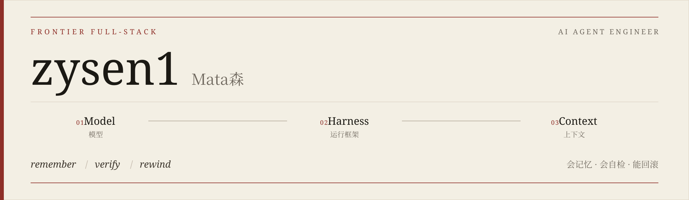
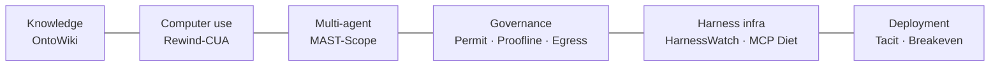

  

  <strong>Frontier full-stack AI agent engineer</strong> 
  <strong>前沿全栈 AI Agent 工程师</strong>

  <em>I build agents that remember, verify, and can be rewound.</em> 
  <em>我做会记忆、会自检、能回滚的 Agent。</em>

  Building reliable AI agents — knowledge compilation, memory, computer-use, multi-agent. 
  构建可靠的 AI Agent｜知识编译 · 记忆 · Computer-Use · 多智能体

An agent, the way I build one, is a model, a harness, and a context. Control lives in the harness. Knowledge and memory live in the context. The repositories below are that sentence. Where the default branch has the code, the label is shipped, and the number is the one that repository's README reports, on the dataset named next to it.

我想做的 Agent，就是模型、harness 和上下文。控制在 harness 里，知识和记忆在上下文里。下面这些仓库就是这句话。默认分支上有代码的，标成已发布。数字是那个仓库 README 里写的，旁边注明数据集。

## Now / 正在做

[Proofline](https://github.com/zysen1/Proofline), [MCP-Diet](https://github.com/zysen1/MCP-Diet), and [Egress-Ledger](https://github.com/zysen1/Egress-Ledger) are on `main`. The open work is a measurement inside each one, not the repository.

[Proofline](https://github.com/zysen1/Proofline)、[MCP-Diet](https://github.com/zysen1/MCP-Diet) 和 [Egress-Ledger](https://github.com/zysen1/Egress-Ledger) 已经在 `main` 上。还空着的是每一项里的一次测量，不是仓库本身。

- **Proofline** — shipped. Replaying merged public pull requests has not been run. 
  已发布。还没有回放公开仓库里已合并的 PR。
- **MCP-Diet** — shipped. The real-model arm has not been run. 
  已发布。真实模型那一臂还没有跑。
- **Egress-Ledger** — shipped. A capture of Claude Code, Codex, or another real agent has not been run. 
  已发布。还没有抓过 Claude Code、Codex 或其他真实 agent。

## Flagship / 代表项目

Shipped means the code is on the default branch. It does not mean a customer is running it. Secondary development names the upstream. Original work says so.

「已发布」表示代码在默认分支上，不是说已经跑在客户那里。二次开发写明上游。原创就写原创。

A shelf, in one row, so the directions fit. The line is not a call graph.
排成一排，是为了放下这些方向。这根线不是调用关系。

### Knowledge & memory / 知识与记忆

| Project | What | Measured | Status | Built on |
| --- | --- | --- | --- | --- |
| [OntoWiki](https://github.com/zysen1/OntoWiki) | An ontology-constrained, bi-temporal wiki. Sources are compiled once. Later questions read the graph.  本体约束、带时间的 wiki。来源编译一次，之后的提问读这张图。 | **1.00 vs 0.75** answer hit against TF-IDF vector RAG (k=3). Context 77.8 vs 147.6 tokens.  8 hand-written questions over 13 notes. Self-built regression set, not a leaderboard. LightRAG was not run.  **1.00 对 0.75** 答案命中。上下文 77.8 对 147.6 token。 13 篇笔记上的 8 道手写题，自建回归集，不是排行榜。LightRAG 没有跑。 | Shipped 已发布 | [lucasastorian/llmwiki](https://github.com/lucasastorian/llmwiki) · Apache-2.0  Secondary development. The store is SQLite. Graphiti is an optional mirror. |

### Computer use / 电脑操作

| Project | What | Measured | Status | Built on |
| --- | --- | --- | --- | --- |
| [Rewind-CUA](https://github.com/zysen1/Rewind-CUA) | An action journal, checkpoints, rewind, and escalation when the executor is unsure or policy says ask.  动作日志、检查点、回滚。执行者不确定，或策略要求询问时，升级。 | **6/6 vs 1/6** task success. Irreversible effects that stuck: 0 vs 3.  Six scripted tasks, no model. Cua-Bench and OSWorld were not run.  **6/6 对 1/6**。留下的不可逆副作用 0 对 3。 六个脚本任务，没有模型。Cua-Bench 和 OSWorld 没跑。 | Shipped 已发布 | [trycua/cua](https://github.com/trycua/cua) · MIT  Secondary development. The extension is `libs/rewind-cua`. |

### Multi-agent reliability / 多智能体可靠性

| Project | What | Measured | Status | Built on |
| --- | --- | --- | --- | --- |
| [MAST-Scope](https://github.com/zysen1/MAST-Scope) | Classify the failure, name the first bad step, repair that sub-task.  判定失败类型，指出第一个出错的步骤，只重规划那一个子任务。 | **1.00** primary-mode accuracy (15/15). Repair left 14/14 failure traces clean.  15 seeded incidents, self-built. Not the paper's MAST-Data (1,600+ traces).  主模式准确率 **1.00**（15/15）。14/14 条失败轨迹被修干净。 15 个种子事故，自建。不是论文的 MAST-Data（1600 多条）。 | Shipped 已发布 | Original · Apache-2.0  Uses the [OpenAI Agents SDK](https://github.com/openai/openai-agents-python), [LangGraph](https://github.com/langchain-ai/langgraph), [Agent Framework](https://github.com/microsoft/agent-framework), and [Inspect AI](https://github.com/UKGovernmentBEIS/inspect_ai). |

### Agent security & governance / Agent 安全与治理

| Project | What | Measured | Status | Built on |
| --- | --- | --- | --- | --- |
| [PermitTrace](https://github.com/zysen1/PermitTrace) | Every permission has a provenance. Trace the inducement, measure the blast radius, then allow, narrow, ask, or deny.  每一次放行都要有出处。溯源诱导、量爆炸半径，再决定放行、收窄、询问或拒绝。 | **100%** held-out high-risk detection (12/12 attacks), **8.3%** false positives (1/12 benign).  AllowRuleBench-mini held-out: 24 synthetic scenarios, self-built, shaped after arXiv:2610.22987. Not that paper's data.  留出集高风险检出 **100%**（12/12），误报 **8.3%**（1/12）。 AllowRuleBench-mini 留出集：24 个合成场景，自建，威胁模型参照 2610.22987。不是那篇论文的数据。 | Shipped 已发布 | Original · Apache-2.0  Go. Claude Code hooks are live. Codex CLI is not. |
| [Proofline](https://github.com/zysen1/Proofline) | Don't trust the PR description. Check the pull request with execution evidence.  不要信 PR 描述。用执行证据核对这次提交。 | Five slop classes, each **20/20** detection (`passes_before`, `tautology`, `scope_creep`, `broken`, `false_claims`). `real_fix` false positives **0/20**. Mean **3622 ms/case**.  Dataset `synthetic-slop-v1`: 120 generated one-module git repos, pytest. No model API. Public PR replay was not run, so 0/20 is only the synthetic `real_fix` set.  五个 slop 类各 **20/20** 检出。`real_fix` 误报 **0/20**。平均 **3622 ms/例**。 数据集 `synthetic-slop-v1`：120 个生成的单模块 git 仓库，pytest。没有模型 API。公开 PR 回放没跑，所以 0/20 只属于合成的 `real_fix`。 | Shipped 已发布 | Original · Apache-2.0  Go. |
| [Egress-Ledger](https://github.com/zysen1/Egress-Ledger) | A per-version report of what a coding agent sends off the machine. It records. It does not block.  每个版本一份报告：coding agent 向外发了什么。它记录，不拦截。 | `offline-demo-v1`, scripted fake agent: v1.0.0 **154** request body bytes, secret findings **0**; v1.1.0 **1750** body bytes. Bait seen at `uploads.example-vendor.test` and `git.example-vendor.test`. `pinned.example-vendor.test` is invisible.  `ledger-fixture-v1`: secret **20/20**, git **6/6**, full-file **5/5**.  A real-agent capture was not run.  `offline-demo-v1`，脚本假 agent：v1.0.0 请求 body **154** 字节，密钥发现 **0**；v1.1.0 body **1750** 字节。诱饵出现在 `uploads.example-vendor.test` 和 `git.example-vendor.test`。`pinned.example-vendor.test` 标为不可见。 `ledger-fixture-v1`：密钥 **20/20**，git **6/6**，完整文件 **5/5**。 真实 agent 的抓包没跑。 | Shipped 已发布 | Original · Apache-2.0  Go. |

### Coding-agent infra / Coding-agent 基础设施

| Project | What | Measured | Status | Built on |
| --- | --- | --- | --- | --- |
| [HarnessWatch](https://github.com/zysen1/HarnessWatch) | A behavioral weather report for a coding-agent release: what the harness started doing differently.  coding agent 每个版本的行为天气预报：harness 这次变得不一样的地方。 | **10/10** injected regressions detected, **0/13** false positives on stable controls.  Synthetic fixtures, 368 session files. Not captures from a vendor binary.  注入的回退 **10/10** 被检出，稳定对照误报 **0/13**。 合成夹具，368 个会话文件。不是从厂商二进制抓的。 | Shipped 已发布 | Original · Apache-2.0 |
| [WebMCP-Retrofit](https://github.com/zysen1/WebMCP-Retrofit) | Record one pass through a site, turn the calls into [WebMCP](https://github.com/webmachinelearning/webmcp) tools, and check the contracts.  把网站录一遍，变成 WebMCP 工具，再核对契约还在不在。 | **93/93** contract checks. On the same run, one scripted order: 1,148 vs 37,572 estimated tokens, 35 ms vs 2,014 ms. No model was called.  Five self-built local sites.  契约检查 **93/93**。同一次运行里，一笔脚本下单：估算 token 1,148 对 37,572，35 ms 对 2,014 ms。没有调用模型。 五个自建本地站点。 | Shipped 已发布 | Original · Apache-2.0  TypeScript, against the WebMCP spec. |
| [MCP-Diet](https://github.com/zysen1/MCP-Diet) | Count what an MCP catalog costs in schema tokens, then diet it. A fixed task set shows whether a scripted agent still picks the right tool.  先算 MCP 目录的 schema token，再给它减肥。固定任务集看脚本 agent 还能不能选对工具。 | Selection on `scripted-lexical-v1`, dataset `kitchen-sink-90`: baseline **90** tools / **19494** schema tokens / **7/12**; subset **14** / **3195** / **11/12**; cli-skill **391** standing tokens / **11/12**; lazy **222** standing tokens / **12/12**.  Success is a separate column: 7/12, 10/12, 10/12, 11/12. Real LLM was not run.  选对率，agent `scripted-lexical-v1`，数据集 `kitchen-sink-90`：baseline **90** 个工具 / **19494** schema token / **7/12**；subset **14** / **3195** / **11/12**；cli-skill 常驻 **391** token / **11/12**；lazy 常驻 **222** token / **12/12**。 成功是另一列：7/12、10/12、10/12、11/12。真实 LLM 没跑。 | Shipped 已发布 | Original · Apache-2.0  TypeScript. |

### FDE / 一线部署

Forward-deployed work: the rules a business never wrote down, and the human hours of turning an agent on.

一线部署：业务里没人写下来的规则，以及把 agent 打开之前的人工工时。

| Project | What | Measured | Status | Built on |
| --- | --- | --- | --- | --- |
| [Tacit](https://github.com/zysen1/tacit-fde) | Mine the rules buried in a customer bundle, then compile them into the agent.  把客户资料里没写明的规则挖出来，编译进 agent。 | Held-out success **0.600 / 0.725 / 1.000** (no rules / explicit only / plus tacit).  Ten synthetic estates, five seeds × two templates, 40 held-out cases each. Not a customer archive. Recall of 1.0 is the generator's shape.  留出集成功率 **0.600 / 0.725 / 1.000**（无规则 / 仅显式 / 加上隐性）。 十个合成客户包，五个种子 × 两个模板，每次 40 道留出题。不是客户档案。召回 1.0 是生成器的形状。 | Shipped 已发布 | Original · Apache-2.0 |
| [Breakeven](https://github.com/zysen1/Breakeven) | Freeze the cheapest oversight policy that clears a reliability target, then price the remaining human hours.  冻住「又够可靠、又最省」的监督策略，再给剩下的人工工时计价。 | **147.8 h vs 400 h** all-human, for the policy that goes live (Careful, 82% accurate). The plan that automates 90.5% costs **+23.1%** hours and misses the 95% target.  Synthetic Acme book, 2,000 cases, seed 7. Not a customer ledger, and not an industry ROI.  **147.8 对 400 小时**（稳妥，准确率 82%，可以上线）。自动化 90.5% 的方案工时 **+23.1%**，过不了 95%。 合成的 Acme 账本，2000 件，种子 7。不是客户台账，也不是行业回报率。 | Shipped 已发布 | Original · Apache-2.0 |

## My take on where agents are going / 我对 Agent 走向的判断

Seven judgments. Each one is pinned to a post, a repository, or a paper, and to a project on this page where I have one. Star counts stay off this page; they move.

七个判断。每条都挂着帖子、仓库或论文；这页上有对应项目的，也挂上。这一页不写 star 数，那个数字会变。

### 1 · The harness is the product

**Harness 就是产品。** Agents = model + harness + context; the gains now come from context and control loops, not frameworks.
现在的提升主要来自上下文和控制回路，而不是换一个框架。

On this page that is [HarnessWatch](https://github.com/zysen1/HarnessWatch) for release drift, [MCP-Diet](https://github.com/zysen1/MCP-Diet) for what the tool list costs in context, [Rewind-CUA](https://github.com/zysen1/Rewind-CUA) for the computer-use loop, and [MAST-Scope](https://github.com/zysen1/MAST-Scope) for the multi-agent one. [Proofline](https://github.com/zysen1/Proofline) checks the pull request against execution, not against the write-up.
在这页上，[HarnessWatch](https://github.com/zysen1/HarnessWatch) 看版本漂移，[MCP-Diet](https://github.com/zysen1/MCP-Diet) 看工具列表占掉多少上下文，[Rewind-CUA](https://github.com/zysen1/Rewind-CUA) 是电脑操作的控制回路，[MAST-Scope](https://github.com/zysen1/MAST-Scope) 是多智能体的。[Proofline](https://github.com/zysen1/Proofline) 拿执行证据核对 PR，不拿文案核对。

- Harrison Chase — [agents = model + harness + context](https://x.com/hwchase17/status/2088653366335582629) (2026-08). [Claude Code and Manus share that shape: model + runtime + harness](https://x.com/hwchase17/status/2034297125417460044) (2026-03).
- OpenAI — [the Agents SDK harness, open-sourced](https://x.com/OpenAIDevs/status/2044466699785920937) (2026-04); [the Codex harness](https://x.com/OpenAIDevs/status/2090230646497251387) (2026-08).
- The repositories that moved are harnesses and plugin catalogs: [ECC](https://github.com/affaan-m/ECC), [deepseek-harness](https://github.com/deepseek-ai/deepseek-harness), [Archon](https://github.com/coleam00/Archon).
- Papers — [AI Agents Do Not Fail Alone: The Context Fails First](https://arxiv.org/abs/2607.14275). [Agentic Context Engineering](https://arxiv.org/abs/2510.04618): context as a playbook you can evolve.

### 2 · Compile knowledge, don't re-retrieve it

**知识要编译，而不是每次重新检索。** LLM-maintained wikis beat query-time RAG for accumulating synthesis — but they need types, time, and provenance.
LLM Wiki 会让知识持续积累，但它需要本体、时间维度和溯源。

[OntoWiki](https://github.com/zysen1/OntoWiki) is that compiler, on top of llmwiki. The 1.00 versus 0.75 is a closed set of eight questions. It is large enough to regress the compiler and too small to boast about.
[OntoWiki](https://github.com/zysen1/OntoWiki) 就是这个编译器，建在 llmwiki 上。1.00 对 0.75 是八题的封闭集，够做回归，不够拿来吹。

- Andrej Karpathy — [LLM Wiki](https://gist.github.com/karpathy/442a6bf555914893e9891c11519de94f) (2026-04): raw sources, a wiki the model maintains, a schema. Three operations: ingest, query, lint. The personalization he argues for is [explicit and inspectable](https://x.com/karpathy/status/2040572272944324650).
- Jerry Liu — [“Retrieval Harness is the 2026 version of RAG”](https://x.com/jerryjliu0/status/2071729856900215261). [The context layer may be one of the few moats of 2026](https://x.com/jerryjliu0/status/2053178322495152261).
- Implementations — [llmwiki](https://github.com/lucasastorian/llmwiki), [llm-wiki-compiler](https://github.com/atomicstrata/llm-wiki-compiler), [nvk/llm-wiki](https://github.com/nvk/llm-wiki).
- Preregistered comparisons — [Single-Round Vector RAG vs an LLM-Compiled Wiki](https://arxiv.org/abs/2605.18490), [Progressive Disclosure for LLM-Maintained Wiki](https://arxiv.org/abs/2607.04576).
- A flat markdown wiki still lacks types, time, and provenance. What that leaves open is a bi-temporal graph ([Graphiti](https://github.com/getzep/graphiti)), ontology-constrained GraphRAG ([BEACON-SP](https://arxiv.org/abs/2610.09026)), and [a GraphRAG workspace you can audit and steer](https://arxiv.org/abs/2610.23559).

### 3 · Memory belongs inside the harness, consolidated offline

**记忆应该放进 harness，并在后台离线整理（“做梦”）。**

[OntoWiki](https://github.com/zysen1/OntoWiki)'s lint is that offline pass: it writes a review and does not edit the graph. [Tacit](https://github.com/zysen1/tacit-fde) is the other consolidation, mining rules out of a bundle and compiling them into the harness.
[OntoWiki](https://github.com/zysen1/OntoWiki) 的 lint 就是这个离线过程：它写审阅，不改图。[Tacit](https://github.com/zysen1/tacit-fde) 是另一种整理，从资料包里挖规则，再编译进 harness。

- Harrison Chase — memory never quite landed, he argues, because [it has to be built into the harness](https://x.com/hwchase17/status/2099858455079026817) (2026-09). The direction he flags is [dreaming, async sub-agents, heartbeats, and an agent that schedules itself](https://x.com/hwchase17/status/2110813795245249018) (2026-10). One instance: [openwiki reads traces and writes them back into a repository wiki](https://x.com/hwchase17/status/2082536230181650862).
- In the wild — [claude-mem](https://github.com/thedotmack/claude-mem) compresses a session and injects it into the next. [ai-memory](https://github.com/akitaonrails/ai-memory) (Rust) shares long-term memory across coding harnesses.
- Papers — [ReasoningBank](https://arxiv.org/abs/2509.25140), [Memento](https://arxiv.org/abs/2508.16153), [MemOS](https://arxiv.org/abs/2507.03724). The eval has to move with the claim: [downstream QA is not enough](https://arxiv.org/abs/2610.22209).

### 4 · Computer-use 2.0 is background, window-scoped, and reversible

**Computer-Use 2.0：后台运行、按窗口操作、小模型执行，同时必须可监督、可回滚。**

[Rewind-CUA](https://github.com/zysen1/Rewind-CUA) is the reversible half, on top of Cua. The 6/6 is six scripted tasks. It is not a Cua-Bench score.
[Rewind-CUA](https://github.com/zysen1/Rewind-CUA) 是可回滚的那一半，建在 Cua 上。6/6 是六个脚本任务，不是 Cua-Bench 的分数。

- Cua — the loop is leaving “screenshot plus cursor” for [window-scoped actions, orchestrated by a coding agent](https://x.com/trycua/status/2064744390615343480). They shipped [CUA-S1](https://x.com/trycua/status/2101014004927729737), a small model for computer-use decisions, and [trained it with RLOO on real tasks](https://x.com/trycua/status/2102800643794591833).
- [Gemini 3.5 Flash has native computer use](https://x.com/GoogleDeepMind/status/2070180509523546481). On professional software the hit rate is still low. On 25 KiCad tasks in Cua-Bench, [Cua reports the best model finished 6](https://x.com/trycua/status/2066597808132776150). That figure is theirs.
- The papers are about supervision and recovery. [LEASH](https://arxiv.org/abs/2610.22280) escalates under uncertainty. [Task-State Governance](https://arxiv.org/abs/2610.20100) makes GUI execution verifiable and recoverable. [GraceBench](https://arxiv.org/abs/2610.19900) asks why a GUI agent fails. Practitioners are asking for [a safe harness: ACLs, no silent deletes, versioned actions](https://x.com/mr_bytestorm/status/2078125282654027949).

### 5 · Multi-agent is bottlenecked by observability

**多智能体的瓶颈在可观测性和失败归因，而不是 agent 的数量。**

Role-play chat is giving way to async fleets and an orchestrator. Tracing is already common. Automatic detection, attribution, and repair are the open work.
角色扮演式聊天正在让位给异步子 agent 舰队加编排。追踪已经常见。还没做完的是自动检测、归因和修复。

[MAST-Scope](https://github.com/zysen1/MAST-Scope) is that missing piece on a seeded set: detect, blame, repair. The 1.00 is fifteen incidents, not the paper's 1,600 traces.
[MAST-Scope](https://github.com/zysen1/MAST-Scope) 在种子集上补的就是这一块：检测、归因、修复。1.00 是十五个事故，不是论文的 1600 条轨迹。

- [Orca](https://github.com/stablyai/orca) runs coding agents in parallel. [Simon Willison on the GPT-5.6 API](https://x.com/simonw/status/2075306164993315192): multi-agent and programmatic tool calling. DeepMind’s [Co-Scientist](https://x.com/GoogleDeepMind/status/2061857539977842793) generates, debates, and evolves.
- [Why Do Multi-Agent LLM Systems Fail?](https://arxiv.org/abs/2503.13657) is the MAST taxonomy. [HTN-Orchestrate](https://arxiv.org/abs/2610.22195) is one way to replan the piece that failed.

### 6 · Personal agents and organizational agents will diverge

**个人 Agent 和组织 Agent 会分化。** A personal agent needs shared ground — what the two of you have already confirmed — and memory with a permission boundary.
个人 Agent 的关键是共同认知（彼此已经确认过什么），以及带权限的记忆。

The company side of that split, here, is [Tacit](https://github.com/zysen1/tacit-fde) and [Breakeven](https://github.com/zysen1/Breakeven): the rules a workflow never wrote down, then the human hours of going live. The permission boundary that shipped is [PermitTrace](https://github.com/zysen1/PermitTrace). [Egress-Ledger](https://github.com/zysen1/Egress-Ledger) is the other edge: what a version sent off the machine, so far on a scripted agent.
在这页上，组织这一侧是 [Tacit](https://github.com/zysen1/tacit-fde) 和 [Breakeven](https://github.com/zysen1/Breakeven)：流程里没写下来的规则，然后是上线的人工工时。已经发布的权限边界是 [PermitTrace](https://github.com/zysen1/PermitTrace)。[Egress-Ledger](https://github.com/zysen1/Egress-Ledger) 是另一条边界：一个版本向外发了什么。目前测的是脚本 agent。

- Harrison Chase separates [a company OS, many principals and one executor, from a personal agent](https://x.com/hwchase17/status/2104940633018577400).
- The personal-agent codebases in the wild are [Hermes Agent](https://github.com/NousResearch/hermes-agent) and [OpenBot](https://github.com/CopilotKit/OpenBot). I have not shipped a plugin for either.
- [Knowing the User Is Not Knowing What We Established](https://arxiv.org/abs/2610.18684). [X-AgentRed](https://arxiv.org/abs/2610.13886) red-teams the personal agent. [SAFE-Mem](https://arxiv.org/abs/2610.22959) puts a fine-grained authority on each memory.

### 7 · Self-improve in context first, RL second

**先在上下文层自我改进，再上 RL。** A large share of the gain is available before any weight update. Train when the context loop runs out of road.
很大一部分收益，在改权重之前就能拿到。上下文这条路走到头，再训练。

Every number in the tables above was measured with the weights left alone.
上面表里的每个数字，都是在没改权重的情况下测的。

- Before a gradient: [Training-Free Group Relative Policy Optimization](https://arxiv.org/abs/2510.08191), [Agentic Context Engineering](https://arxiv.org/abs/2510.04618), [ReasoningBank](https://arxiv.org/abs/2509.25140).
- When training is the right next step: [ART](https://github.com/OpenPipe/ART), [Agent Lightning](https://github.com/microsoft/agent-lightning), [verl](https://github.com/verl-project/verl). Cua’s [RLOO run](https://x.com/trycua/status/2102800643794591833) is the shape I trust: a small model, a real environment, a harness that already exists.

## Stack / 技术栈

  

  
  
  
  

The icons are languages in the shipped repositories. The badges are protocols and runtimes those repositories actually sit on.

图标是已发布仓库里的语言。徽章是这些仓库真正接上的协议和运行时。

| Piece | Where it earns a place |
| --- | --- |
| Python | OntoWiki, MAST-Scope, HarnessWatch, Tacit, Breakeven. |
| TypeScript, Next.js | OntoWiki's timeline, MAST-Scope's replay, WebMCP-Retrofit, MCP-Diet. |
| Rust | Rewind-CUA's journal, checkpoints, and policy, beside the Cua driver. |
| Go | PermitTrace, Proofline, Egress-Ledger. |
| MCP | OntoWiki's query, claim, provenance, `at`, and lint. Tacit compiles a FastMCP server. MCP-Diet scans a catalog and diets it. |
| WebMCP | WebMCP-Retrofit, checked against the spec. |
| OpenAI Agents SDK, LangGraph, Agent Framework, Inspect AI | MAST-Scope's adapters and the offline eval. |
| SQLite | OntoWiki's bi-temporal graph. Graphiti is an optional mirror, not the store. |

A2A is not wired in a shipped repository here.
这页已发布的仓库里没有接上 A2A。

## Reading / 书单

One paper per judgment. The links above are the rest of the shelf.

每个判断留一篇。上面的链接是其余的架子。

1. **[Agentic Context Engineering: Evolving Contexts for Self-Improving Language Models](https://arxiv.org/abs/2510.04618)** (2025). Context as a playbook you revise. 
   上下文是一份可以改写的 playbook。
2. **[Training-Free Group Relative Policy Optimization](https://arxiv.org/abs/2510.08191)** (2025). Relative advantage over sampled traces, with the weights left alone. 
   同一任务采样多条轨迹，按相对优势更新经验，权重不动。
3. **[Single-Round Vector RAG vs an LLM-Compiled Wiki](https://arxiv.org/abs/2605.18490)** (2026). A preregistered comparison. 
   预注册的对照。
4. **[Why Do Multi-Agent LLM Systems Fail?](https://arxiv.org/abs/2503.13657)** (2025). The MAST taxonomy MAST-Scope is scored against, on a seeded set rather than the paper's traces. 
   MAST-Scope 对着的失败分类。打分用的是种子集，不是论文的轨迹。
5. **[LEASH: Uncertainty-Aware Weak-to-Strong Escalation and Oversight for Computer-Use Agents](https://arxiv.org/abs/2610.22280)** (2026). When the step is unsure, hand it up. 
   这一步不确定，就交上去。
6. **[Task-State Governance: A Virtual Machine for Verifiable and Recoverable GUI Agent Execution](https://arxiv.org/abs/2610.20100)** (2026). Check the state, then restore it. 
   先校验状态，再恢复。
7. **[Knowing the User Is Not Knowing What We Established: Grounding Awareness in Personal Agents](https://arxiv.org/abs/2610.18684)** (2026). Shared ground, rather than a dossier on the user. 
   要的是共同认知，而不是一份用户档案。

Field note, separate from the papers: Karpathy’s [LLM Wiki](https://gist.github.com/karpathy/442a6bf555914893e9891c11519de94f) is why OntoWiki is a wiki with a schema, rather than another vector index.

论文之外的那份笔记：Karpathy 的 [LLM Wiki](https://gist.github.com/karpathy/442a6bf555914893e9891c11519de94f)。OntoWiki 因此是一份带 schema 的 wiki，而不是又一个向量索引。

---

Forks keep the upstream license. The numbers above are copied from each repository's README, and the dataset is the one that README names. Still unmeasured, and marked that way in those READMEs: Proofline's replay of merged public pull requests, MCP-Diet's real-model arm, and Egress-Ledger's capture of a real coding agent.

Fork 保留上游许可证。上面的数字抄自各仓库的 README，数据集也是 README 里写的那个。这些 README 自己标成还没测的：Proofline 回放已合并的公开 PR，MCP-Diet 的真实模型臂，以及 Egress-Ledger 对真实 coding agent 的抓包。
